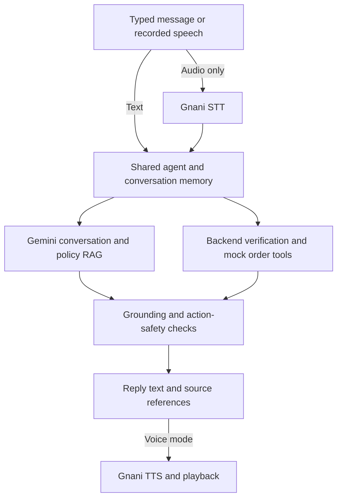
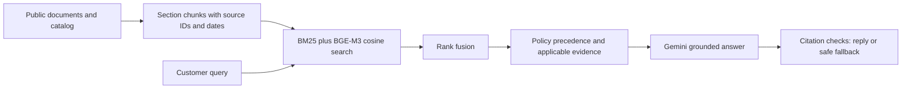

# ZentroMart AI Support Agent

A text and voice support assistant for ZentroMart, the fictional Indian retailer
in the IIT Guwahati Consulting & Analytics Club x Gnani.ai capstone. It combines
Gemini conversation planning, document-grounded answers, verified synthetic
order lookups and Gnani speech recognition and synthesis.

This is a local educational application, not a production service. Tickets are
local mock records, not messages to a real team. The agent cannot issue refunds
or cancel orders. See the [submission checklist](SUBMISSION.md) for outstanding
requirements; the application is not yet a complete submission.

## Evaluator overview

| Area | Current implementation / evidence |
| --- | --- |
| Interface and orchestration | Streamlit with a shared custom Python support controller; text, dictation and voice use the same agent factory |
| Conversation and generation | Gemini structured dialogue planning and document-grounded generation |
| Selected retrieval | BM25 + BGE-M3 dense embeddings, reciprocal-rank fusion, exact NumPy cosine search; no cross-encoder by default |
| Voice | Gnani STT and TTS through a local WebSocket relay; sequential listening and playback |
| Dataset validation | 9 CSVs, 21 KB documents, 1,000 synthetic orders, 1,783 order items and 244 historical logs |
| Practice evaluation | 52 questions and 23 conversations / 96 customer turns available; completed experiments below cover questions, not a full conversation benchmark |
| Regression checks | 339 Python tests passed on 1 November 2026, including batch audio, release, conversation/presentation and 4 startup checks; frontend composer checks also passed |
| Batch audio | Six live audio turns completed across three cases, including four-turn context/language switching; see sample outputs |
| Submission status | Owner reviewed generated speech; styled four-page report prepared; final behaviour checks and demo video remain |

The measured experiments answer different questions: **does document grounding
help Gemini?** and **which retriever should the app use?** Their scores must not
be combined into an overall accuracy claim. See [measured results](#measured-results).

## What it does

- Discuss delivery, returns, refunds, cancellations, warranty and public products.
- Retrieve company sources and show supporting policy sections.
- Ask natural follow-up questions using bounded conversation context.
- Verify an order before revealing synthetic records or calculated estimates.
- Follow English, Hindi and Hinglish, including changes within a conversation.
- Accept typed messages, editable dictation or an automatic voice conversation.
- Create local handover tickets when enabled and confirmed by the actual tool.

## Install and run

Use Python 3.11 or newer; development has used Python 3.13. In PowerShell:

```powershell
git clone https://github.com/brindoxx/ZentroMart-AI-Support-Agent.git
cd ZentroMart-AI-Support-Agent
python -m venv .venv
.\.venv\Scripts\python.exe -m pip install -r requirements.txt
Copy-Item .env.example .env
```

Cloning requires access while the repository is private. Do not overwrite an
existing `.env`. Add Gemini and Gnani keys there, never in chat or Git.

Obtain the course dataset separately. Its extracted directory must contain
`kb/`, `data/`, `practice/` and `tools/`. Set `DATASET_DIR` to that location;
the local default is `dataset`. Its supplied documentation defines the schema.

```powershell
.\.venv\Scripts\python.exe -m zentromart validate
.\.venv\Scripts\python.exe -m streamlit run streamlit_app.py
```

Open `http://127.0.0.1:8501`. Restart the server after changing ASGI/WebSocket
routes. The current relay deliberately accepts local origins only; public
hosting needs a separate deployment/security review.

### Startup preparation

The ASGI startup hook prepares public KB/catalog sections, the business calendar,
the selected retrieval index and its local query encoder before serving the app.
A fixed public `support` search warms model loading/tokenization/inference even
when document vectors were already cached. The UI reuses those exact bounded
cache entries; opening a tab or sending the first message does not rebuild them.
Only the selected encoder/reranker is loaded, not every experimental model.

Wait for **`ZentroMart ready: public resources warmed`** in the terminal before
recording the demo. Startup takes longer by design; missing model files can need
a first-time public download unless offline mode is set. Preparation failures stop
startup with a safe setup error, not a silent search fallback.

Gemini and WebSocket libraries are pre-imported, but startup does not create
credential-bearing clients, call Gemini/Gnani, record a microphone, create tickets
or share private order/session state. Cloud connections and response latency
still occur after consent when you actually ask a question or start voice.

A local cached-BGE check with all provider call methods blocked prepared resources
in about 17.2 seconds; a subsequent five-result search took 0.15 seconds and reused
the same index. These are one-machine local timings, not end-to-end chat latency.

## Using the assistant

Confirm the one-time in-chat cloud-processing notice before starting. Confirmation
alone does not record audio or call a provider.

- **Text:** type and press Send or Enter.
- **Mic:** completed Gnani phrases appear in the input. Stop, edit if needed and
  Send. Dictation alone does not call Gemini.
- **Voice:** speak and pause. The same agent answers, Gnani TTS plays its reply,
  and listening resumes after playback. Click the voice button again to stop.
- **Order help:** enter the synthetic eight-digit order ID, then the requested
  phone suffix or pincode in the masked field. Voice pauses for verification.
  Never speak verification proofs.
- **Demo options:** guided synthetic orders provide tutorial credentials. Mock
  ticket creation is a separate opt-in and does not contact a human team.

**Demo handover tickets are not approvals.** Enabling that setting only permits
the local mock ticket tool to write a CSV when a handover is requested. A ticket
is reported as created only after executor confirmation. With it off, the agent
can recommend human review but must not claim a ticket exists. Neither setting
authorizes a refund, cancellation or real support notification.

Reply language follows the current message without a selector. Gemini chooses
language in its existing dialogue request; private steps use local language cues,
and numeric proofs preserve the current language. TTS uses the reply language.
Mixed Hindi/English STT may return Roman script, so language choice depends on
the actual transcript.

Gnani provides completed phrases after pauses, not per-word interim text. Voice
is sequential: listening stops during playback; interruption/barge-in is not
implemented. The user reported a successful live loop; this is not a repeatable
multi-language reliability benchmark.

## Architecture



GitHub renders these Mermaid blocks as diagrams. Dictation only prepares text;
it does not call Gemini until the message is sent. Voice mode submits a completed
speech turn and speaks the resulting reply. Verification/private workflow steps
can be handled locally, so not every turn makes a Gemini request.

Gemini proposes a structured next step; application code validates and dispatches
it. The model cannot authorize verification or invent executor results. Verified
order records and proofs do not enter its dialogue prompt. Verified synthetic
details can appear in replies sent to Gnani TTS, as disclosed before chat starts.

### Retrieval and policy

Ingestion preserves section IDs, source locations, status and effective dates.
Current policies take precedence over agent guides, help, FAQs and marketing,
with scoped historical, festive and marketplace exceptions. Historical support
logs are not policy authority.

**The main UI defaults to hybrid BM25 + BGE-M3 dense retrieval, without reranking.**
Document embeddings use a local NumPy cosine-search index; reciprocal-rank fusion
combines lexical and semantic results. The public index and encoder are cached
across reruns, while conversation state remains per tab. CPU encoder access is
serialized. Set `RETRIEVER=bm25` or `semantic` explicitly to compare methods;
missing vector dependencies/cache cause a setup error, not silent fallback.
Restart the app after changing retrieval configuration.



This is the selected public-policy path, not a diagram of private order lookup.
Gold evaluation labels and historical support logs are not policy authority.

The measured choice and its limitations are in [retrieval experiments](evals/retrieval-experiments.md).
E5-small remains a lower-latency alternative. Local experiments support `EMBEDDING_MODEL=e5-small` or `bge-m3`, and
`RERANKER=none` or `mmarco-minilm`. Models use pinned revisions, CPU inference,
model-specific prefixes/pooling and separate vector caches. BGE-M3's publisher
checkpoint is loaded with PyTorch >=2.6 in explicit weights-only mode; remote
Python code is disabled. The reranker scores only the top 20 public candidates;
policy authority and date applicability are still enforced afterwards.

```powershell
.\.venv\Scripts\python.exe -m zentromart.evaluation.retrieval_experiment --models e5-small bge-m3 --offline --rerank
```

The experiment compares top-5/top-20 text and supplied ASR-like queries, records
per-language metrics and warm latency, and makes no Gemini/Gnani calls. Remove
`--offline` only when a model download is intended. Model downloads/warm-up are
excluded from warm query latency. Candidate reranking must earn its additional
latency; it is not assumed to improve quality. NumPy's exact cosine scores are
also checked against an independent SciPy calculation, not a FAISS benchmark.

Calculations use **20 October 2026**, the dataset reference date. Business days
are Monday-Saturday excluding supplied holidays; return windows use calendar days.

## Configuration

Environment variables override `.env`. Relative paths resolve from the project
root. The UI can also read a server-side Streamlit `[llm]` secret containing
`provider`, `model` and `api_key`.

| Variable | Purpose |
| --- | --- |
| `DATASET_DIR` | Extracted course dataset; default `dataset` |
| `ARTIFACTS_DIR` | Generated indexes, evaluations and tickets; default `artifacts` |
| `RETRIEVER` | `hybrid` (default), `semantic`, or explicitly selected `bm25` |
| `RETRIEVAL_OFFLINE` | `true` uses only an already-downloaded encoder; default `false` |
| `EMBEDDING_MODEL` | `bge-m3` (default) or lower-latency `e5-small` |
| `RERANKER` | `none` (default); optional `mmarco-minilm` regressed in the measured trial |
| `DATASET_REFERENCE_DATE` | Must remain `2026-10-20` |
| `LLM_PROVIDER` | `gemini` |
| `LLM_MODEL` | Explicit Gemini model ID; see the key-free example configuration |
| `LLM_API_KEY` | Gemini key; access and quota depend on the account |
| `LLM_TIMEOUT_SECONDS` | Timeout; default 20 seconds |
| `LLM_MAX_OUTPUT_TOKENS` | Output budget; default 1024 |
| `LLM_RETRIES` | Bounded transient-failure retries; default 1 |
| `GNANI_API_KEY` | Key for both Gnani STT and TTS |

No model or speech provider is silently substituted. Gnani is the only speech
provider; no browser Web Speech fallback is used.

## Diagnostics and tests

```powershell
# Offline inspection, validation and configuration check
.\.venv\Scripts\python.exe -m zentromart inspect --json
.\.venv\Scripts\python.exe -m zentromart validate
.\.venv\Scripts\python.exe -m zentromart llm-check

# Synthetic live check; consumes Gemini quota
.\.venv\Scripts\python.exe -m zentromart llm-check --live

# Retrieval without generation
.\.venv\Scripts\python.exe -m zentromart search "reverse pickup fee" --top-k 5

# Optional semantic/hybrid retrieval and comparison
.\.venv\Scripts\python.exe -m pip install -r requirements-semantic.txt
.\.venv\Scripts\python.exe -m zentromart compare-retrieval

# Offline regression tests
.\.venv\Scripts\python.exe -m unittest discover -s tests -v
node tests/composer_frontend.mjs
```

Node.js is needed only for the frontend logic test, not the app. Semantic search
downloads its pinned encoder on first use. After download, `--offline` prevents
encoder downloads; it does not make Gemini offline. For dataset/BM25 work only,
install `requirements-core.txt`. Other requirements files select model, UI,
speech or semantic extras.

The UI, voice, CLI `chat` and `evaluate --agent support` use the same
`application.create_agent` factory and LLM-led controller. Public retrieval is
reused; every conversation gets fresh memory, verification and tool state.
`chat --support` remains a compatibility alias. CLI `answer`, `gemini` and
`gemini-stateful` evaluation adapters are explicit diagnostic/ablation modes.
See [evaluation](evals/README.md) for commands and quota controls.

The evaluation-only `prompt-only` adapter calls Gemini without documents or tools.
`compare-answers` compares it with stateless RAG on identical questions and model
settings. Full `support` evaluation measures the conversational agent separately.
Additional live runs consume project quota; the results below are already measured.

## Measured results

Measured on **31 October 2026**, using the supplied practice set. These are
development-set results, not an unseen-test benchmark. There is no validated
single overall accuracy score, and unit-test counts are not answer-quality scores.

### 1. Prompt-only Gemini versus document-grounded RAG

Both arms used the same 52 original-text questions and requested
`gemini-3.5-flash-lite` model, with a 1024-token output budget. The RAG arm used
**E5-small**, not the subsequently selected BGE-M3 encoder. This stateless
experiment does not score the full UI conversation controller or voice pipeline.

| Metric | Prompt-only Gemini | E5 hybrid RAG | What is measured |
| --- | --- | --- | --- |
| Decision agreement | 32.7% (17/52) | 48.1% (25/52) | Whether answer / clarify / refuse / escalate matches an allowed action |
| Required-fact lexical coverage | 12.2% | 38.8% | Mean matching required facts across 49 applicable questions; not semantic correctness |
| Declared language agreement | 86.5% (45/52) | 94.2% (49/52) | Returned language label, not independent fluency review |
| Retrieval Hit@5 | 0% (no retrieval) | 83.0% (39/47) | At least one expected source among five results |
| Retrieval Recall@5 | 0% | 55.7% | Mean expected-source coverage across 47 gold-evidence cases |
| Citation precision | N/A | 76.7% | Mean expected-ID precision across 35 responses containing citations |
| Citation recall | 0% | 39.4% | Mean expected-source coverage across 47 cases |

- Both arms completed 52/52; **104 generation attempts**, zero provider/adapter errors.
- RAG returned 44 accepted generated answers and **8 citation-mismatch safe fallbacks**.
  These are grounding failures, not network failures; they remain an improvement target.
- No forbidden-claim lexical hits occurred in the eight labelled cases. This small
  lexical check is not a general safety guarantee.
- Calls were paced at five-second intervals, with a 250,000-input-TPM guard and
  no automatic provider retries. This does not control other clients' quota usage.

Decision agreement checks the action, not every claim. Lexical coverage can miss
valid paraphrases or accept misleading wording. Citation-ID matches do not prove
that the cited passage supports the answer. See the [full experiment and
reproduction command](evals/results.md) for configuration, hashes and limitations.

### 2. Embedding and cross-encoder experiments

The framework, chunking, BM25 and reciprocal-rank fusion stayed unchanged.
Each input variant had 52 queries, of which **47 had gold evidence IDs**.
ASR-like inputs are supplied text variants, not newly recorded speech or a Gnani
recognition benchmark. These runs made **zero Gemini/Gnani calls**.

| Configuration | Text Hit@5 | Text Recall@5 | ASR-like Hit@5 | ASR-like Recall@5 | Approx. warm search time |
| --- | --- | --- | --- | --- | --- |
| E5-small hybrid | 39/47 (83.0%) | 55.7% | 37/47 (78.7%) | 54.6% | 32 ms |
| **BGE-M3 hybrid: selected** | **41/47 (87.2%)** | **57.8%** | **39/47 (83.0%)** | **55.7%** | **246-271 ms** |
| E5-small hybrid + MiniLM cross-encoder | 36/47 (76.6%) | 53.9% | 33/47 (70.2%) | 50.7% | 1.68-1.70 s |
| BGE-M3 hybrid + MiniLM cross-encoder | 36/47 (76.6%) | 54.6% | Not run | Not run | 1.80 s |

Hit@5 asks whether any expected evidence was found; Recall@5 asks how much of the
expected evidence was found. Neither measures generated answer correctness.
The reranker scored 20 hybrid candidates before returning five. The final
BGE-plus-reranker check was deliberately text-only to bound development time.

Additional base-retrieval diagnostics:

| Encoder / input | Hit@20 | Recall@20 | MRR@5 | MRR@20 |
| --- | --- | --- | --- | --- |
| E5-small / text | 46/47 (97.9%) | 86.2% | 0.522 | 0.536 |
| E5-small / ASR-like | 47/47 (100%) | 86.5% | 0.511 | 0.531 |
| BGE-M3 / text | 45/47 (95.7%) | 88.7% | 0.543 | 0.552 |
| BGE-M3 / ASR-like | 46/47 (97.9%) | 83.7% | 0.584 | 0.600 |

MRR is the mean reciprocal rank of the first expected source: earlier is better,
with zero when no expected source is in the returned list. Reranked MRR@5 was
0.540 / 0.443 for E5 text / ASR-like and 0.529 for BGE text.

**Selection:** BGE-M3 improves top-five hits by two questions in each variant;
the tested cross-encoder reduces evidence coverage and is therefore disabled.
E5-small remains available for lower-latency machines. These results do not prove
all cross-encoders are ineffective or that BGE improves every retrieval depth.

The corpus contains 154 public sections/catalog records. E5 uses 384-dimensional
mean-pooled vectors with query/passage prefixes; BGE-M3 uses 1024-dimensional
CLS-pooled dense vectors without prefixes. Both were evaluated on CPU with a
512-token maximum. The reranker is
`cross-encoder/mmarco-mMiniLMv2-L12-H384-v1`; pinned revisions and commands
are recorded in [retrieval experiments](evals/retrieval-experiments.md).

Warm timings exclude downloads, model loading and document embedding; some runs
overlapped other CPU work, so they are approximate. BGE's checkpoint is about
2.27 GB and costs more memory than E5. The initial BGE report's pooling descriptor
was corrected without changing its actual publisher-defined CLS computation.

NumPy exact cosine scores matched an independent SciPy calculation. FAISS was
not benchmarked: switching storage with identical vectors and an exact metric
would not itself improve relevance. BGE sparse/multi-vector modes were not tested.

**Important:** the historical 48.1% decision-agreement result belongs to the E5
RAG experiment. BGE has only the retrieval evidence shown here; its end-to-end
answer quality and complete voice-agent reliability remain unmeasured.

### Evidence and validation status

Detailed reports retain aggregate/per-case metrics and configuration, not raw
prompts, replies, keys or proofs. Generated report JSON lives under ignored
`artifacts/evals/`; tracked [answer results](evals/results.md) and
[retrieval results](evals/retrieval-experiments.md) record the local run IDs and
reproduction steps. The latest 339-test regression suite and frontend composer
check passed on 1 November; dataset validation passed after selecting BGE. A cached offline app-index smoke
check also returned five results. The six-file batch check below is a small live
pipeline test, not a full live voice benchmark.

## Privacy, limits and known limitations

- Use only synthetic data and consented recordings.
- Each browser tab owns its chat, verified state and budgets.
- Displayed chat is bounded to 24 messages; the UI saves no transcript/audio export.
- Planning and answering share 20 generation attempts per browser session.
  A policy question normally needs planning plus grounded generation.
- Speech has a separate 20-attempt session budget, 15-second captures and
  an 800-character limit per spoken reply.
- Clearing chat does not reset provider budgets or verification lockouts.
- Model failures currently pause further calls behind a generic warning.
  Category-specific errors and explicit model recovery controls remain unfinished.
  Failed voice turns are not automatically resubmitted.
- Verification and text minimization are educational safeguards, not production
  authentication or comprehensive PII protection.
- Citation-ID validation does not prove the cited passage entails the answer.

### Final conversation reliability changes

The shared controller discloses its AI identity on its first returned reply.
Browser presentation enforces the same for local-first replies, and voice speaks
that displayed reply. Clearing a conversation restores first-reply disclosure
without renewing model budgets or verification lockouts.

Public retrieval now uses bounded earlier customer messages as well as the
current follow-up; it does not index assistant answers or private order/proof
exchanges. Relevant supplied scenario fields are retained until the item/subject
changes. The model still chooses the topic and wording; no damaged-product
answer is hardcoded.

For a citation mismatch or uncited answer, the shared dialogue path permits
**one additional generation** against the same public evidence. All original
validation guards apply again. No rejected draft is displayed, no missing ID is
fabricated, and a second failure stays a safe fallback. Unsafe action claims,
wrong-language drafts, provider/quota failures and invalid structures do not
trigger this correction path. This is distinct from transport retries and uses
the existing generation budget. Stateless benchmark adapters leave it disabled.

Fixed allowlisted diagnostic captions explain failed source/structure/language/
action checks without raw provider payloads, credentials or rejected drafts.
The exact reported greeting/damage/pickup/handover sequence passes a controlled
offline regression, including one deliberately invalid source followed by a
valid corrected draft. An approved **four-turn Gemini-only rehearsal** then
completed the greeting, cited damage answer, context-aware pickup answer and a
confirmed local mock ticket. It used **5 model generations, zero speech requests**;
both policy drafts passed without correction. Its actual output is saved in
`sample_outputs/final_demo_text_rehearsal.json` (local run ID
`20261101T124923Z-4c8753c7`). This is a small live text check, not an accuracy or
voice benchmark. The six saved audio examples remain historical; no new voice
run or improved overall accuracy score is claimed.

Speech-only presentation expands valid ISO dates to day/month/year and groups
labelled eight-digit order IDs for clarity. It strips citation markers for TTS,
preserves prices and written replies, and never guesses a missing year. Batch
and UI use the same speech transport. Pronunciation still needs live rehearsal.

## Repository and submission

| Path | Contents |
| --- | --- |
| `streamlit_app.py`, `chat_app.py` | ASGI launcher and primary UI |
| `src/zentromart/` | Dialogue, retrieval, policy, tools, calculations and speech |
| `tests/` | Offline unit, integration, UI and browser-logic checks |
| `evals/` | Evaluation instructions and limitations |
| `report/report.tex`, `report.pdf` | Editable report source and the submission PDF |
| `SUBMISSION.md` | Evaluator-facing packaging checklist and known release gates |
| `.env.example` | Key-free configuration template |
| `legacy_streamlit_app.py` | Older interface retained for regression tests only |

Learning notes, credentials, environments, caches and runtime artifacts are
ignored by Git. Consented input recordings in `audio_samples/` and generated
replies in `sample_outputs/` are deliberately tracked for reproduction. Supplied
dataset documents are unchanged. Generated audio examples are in
[sample outputs](sample_outputs/README.md). The four-page `report.pdf` is rendered
and visually checked; its editable source is `report/report.tex`. Submission still
needs final behaviour checks, a maximum two-minute demo and a public repository.
The report PDF and its source are included by the release packager. Exclude secrets, environments
and a dataset copy from the submission ZIP; external dataset setup and packaging
still require a clean-environment check.

## Audio-folder evaluation

The batch runner uses **Gnani STT -> the same support-agent factory -> Gnani TTS**,
without opening Streamlit or recording a microphone. It saves each turn's reply
text, generated speech, public source chunks and a safe status record.

Run from the repository root after installing the default requirements. Place
synthetic, consented WAV recordings in `audio_samples/`. The included
`audio_cases.json` describes two independent questions and a four-turn conversation;
the owner's consented recordings are included for reproduction. Do not add real
customer calls or recordings of other people without written consent.

```powershell
# Local WAV/manifest preflight only: no keys, downloads or provider calls
.\.venv\Scripts\python.exe -m zentromart.audio_batch audio_samples --manifest audio_cases.json

# Explicit live run: consumes Gemini quota and Gnani credits, saves outputs
.\.venv\Scripts\python.exe -m zentromart.audio_batch audio_samples --manifest audio_cases.json --live --offline
```

The equivalent submission entry point is
`python run.py audio_samples --manifest audio_cases.json --live`. For a new
evaluator folder of independent questions: `python run.py AUDIO_FOLDER --live`.
Omit `--offline` on first use if the encoder has not yet been downloaded.

`--offline` restricts embedding downloads only; STT, Gemini and TTS still use the
network. Defaults cap the run at 24 generation attempts and 30 speech requests,
pace generations five seconds apart, apply a conservative 250,000-input-TPM guard
and disable automatic model retries. These are local guards, not discovery of
remaining account quota. Failed speech requests count toward the budget too.

Accepted input: **16-bit uncompressed PCM WAV**, mono/stereo, 8-96 kHz, up to
15 seconds and 6 MB per file. Input is converted to 16-kHz mono in memory; the
original is unchanged. Other formats require conversion first, not renaming.

Manifest shape:

```json
{"turns": [
  {"file": "question.wav", "session": "case_01", "language": "en"},
  {"file": "followup.wav", "session": "case_01", "language": "hi"}
]}
```

Rows run in the listed order. Consecutive rows with the same session retain
context; a different session gets fresh memory/verification. Session groups may
not be interleaved. Language is the **STT input hint** (`en`, `hi`, `hi-en`), not a
forced reply language; the support agent still follows the transcript. Without
`--manifest`, sorted root-level WAVs are independent English-hinted cases.

Each execution creates a new folder; it never overwrites an earlier run:

```text
artifacts/audio_runs/<timestamp-and-unique-suffix>/
  summary.json          # Ordered outcomes, stages, errors and configuration
  model_usage.json      # Actual generation attempts and pacing settings
  001/
    result.json         # Minimized transcript, decision, trace, speech confirmation
    reply.txt           # Actual reply; first reply includes AI disclosure
    sources.json        # Public chunks for returned evidence IDs, unresolved IDs explicit
    reply.wav           # 24-kHz mono speech, only after successful generation
  002/ ...
```

Partial failures retain available text/sources but do not claim audio success.
There may be no reply files for a failed STT turn. A failed conversation turn
skips its dependent follow-ups; an independent case can continue. Authentication,
quota and exhausted-budget errors stop the remaining run. Exit codes: 0 means all
turns completed, 1 means incomplete/blocked turns, 2 means setup/preflight failed.
Status completion means pipeline completion, **not factual-answer correctness**.

Replies longer than one TTS request are split into bounded chunks and joined as
WAV without silently truncating the answer. If typed verification is pending,
audio processing stops for that case: proofs must not be spoken or accepted from
audio. Batch outputs intentionally contain synthetic reply text/audio; review
them before sharing. No raw tool arguments or provider exception payloads are
saved. This educational minimization is not a complete PII detector.

### Live batch check

The owner's six recordings were processed with permission on 31 October 2026.
**6/6 turns completed**, with **6 Gemini generation attempts and 12 Gnani requests**,
zero failed/skipped turns and no automatic retries. Two cases were independent;
case 3 retained one session for its four English/Hindi turns. Case 1 generated a
cited damage-policy answer; the continued case retained item context, asked for
delivery timing, changed language, and requested an order ID before private help.
No refund or private-order outcome was invented.

The run is preserved under
`artifacts/audio_runs/20261031T151324Z-sr7lzhud` and copied into
[sample outputs](sample_outputs/README.md). Nonempty WAV containers and text/source
linkage were inspected. The owner reviewed the generated speech and reported
that the replies sounded good; this is subjective review, not a measured
pronunciation score or proof of factual accuracy/general reliability.
An obsolete capability sentence in the first answer was found during review and
is explicitly documented with the samples rather than hidden or rewritten.
Grounded prompt v4 corrects that instruction; no new live run or answer-quality
benchmark was performed after the correction. Historical scores remain labelled
as v3 results, and the saved samples are unchanged.

## What is inside `artifacts`?

These are **generated local working files**, not source code or a submission ZIP.
The entire directory is ignored by Git. Approximate sizes below are a snapshot
before the first batch run, not fixed requirements.

| Folder | Contents | Approximate size | Keep for submission? |
| --- | --- | --- | --- |
| `models/` | Pinned downloaded E5, BGE-M3 and cross-encoder weights/tokenizers | 3.1 GB | No; download/cache locally through setup |
| `embeddings/` | Document vectors and manifests keyed by corpus/model configuration | 1.4 MB | No; reproducible cache, keep locally for faster startup |
| `evals/` | Timestamped baseline, retrieval and reranking JSON reports | 2 MB | Use measured summaries; optionally selected reviewed reports, not every run |
| `knowledge/` | Generated public knowledge-section exports | 0.1 MB | Not normally; source documents/setup regenerate them |
| `brief-review/` | Local images used to inspect the capstone brief | 0.6 MB | No |
| `ui-check/` | Development UI screenshots | Less than 0.1 MB | No; selected demo material is separate |
| `audio_runs/` | New batch replies, speech, sources and per-turn results | Depends on runs | Review and copy selected successful outputs into `sample_outputs/` for release |
| `tickets/` (when created) | Local mock handover records | Depends on use | No real handover; exclude unless a reviewed synthetic example is relevant |

Many timestamped evaluation folders are normal: each experiment preserves its
own results instead of replacing earlier evidence. Hashed embedding folders
separate incompatible encoders/configurations. **Do not delete everything to
clean up the project:** models would need downloading again and local benchmark
evidence could be lost. No artifacts have been deleted automatically.
