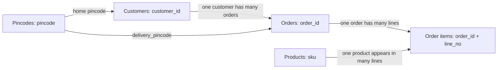

# Phase 2: understand the data before building the agent

## Run it yourself

From the repository root in PowerShell:

```powershell
.\.venv\Scripts\python.exe -m zentromart inspect
.\.venv\Scripts\python.exe -m zentromart inspect --json
.\.venv\Scripts\python.exe -m zentromart validate
.\.venv\Scripts\python.exe -m unittest discover -s tests -v
```

`inspect` prints table sizes, columns, counts of empty cells, key checks,
relationships, and the knowledge document inventory. JSON output includes the
complete column lists and per-column empty-cell counts. It never prints customer
rows, verification values, order details, transcripts, or practice answers.
Inspection does not write files, call a model, import the mock tools, or create
tickets. A failed structural check produces a nonzero exit code.

`validate` runs the original supplied validator in a separate Python process.
Besides keys and relationships, it checks order arithmetic, product consistency,
practice evidence references, conversation turn order, company naming, and the
mock tool's verification boundary. Its ticket check deliberately uses an invalid
short summary, so no ticket is created. Inspection alone is not a replacement
for these deeper checks. The supplied dataset files have not been edited.

## What each file contributes

| Resource | Verified size | Purpose in the future agent |
| --- | ---: | --- |
| `data/customers.csv` | 300 rows | Verification and customer context, behind tools |
| `data/orders.csv` | 1,000 rows | Order state, milestones, amounts, and refunds, behind tools |
| `data/order_items.csv` | 1,783 rows | Individual order lines, behind tools |
| `data/products.csv` | 70 rows | Public product category and warranty facts |
| `data/pincodes.csv` | 36 rows | Delivery, COD, and Express serviceability |
| `data/holidays.csv` | 4 rows | Exceptions to business-day arithmetic |
| `data/support_logs.csv` | 244 records | Optional language/examples analysis; can contain human errors |
| `practice/questions.csv` | 52 questions | Single-turn evaluation and ASR-style text tests |
| `practice/conversations.csv` | 96 turns in 23 conversations | Stateful evaluation, verification, and expected tool calls |
| `kb/*.md` | 21 documents, 84 unique sections | Policy and support guidance for retrieval |

The questions contain 33 English, 8 Hindi, and 11 Hinglish examples. This tells
us to test multilingual retrieval from the beginning. The presence of other
language preferences in customer records does not mean the supplied practice set
tests all those languages.

## How the tables connect



A **primary key** identifies one row. For example, `order_id` must be unique in
`orders.csv`. In `order_items.csv`, neither `order_id` nor `sku` alone identifies
a row: an order contains several items, and the same SKU can occur on different
lines. The pair `(order_id, line_no)` is the composite primary key.

A **foreign key** points to a row in another table. Each order's `customer_id`
must exist in `customers.csv`. Inspection checks nine relationships, including
links from logs and practice conversations. There are zero broken references or
blank references in those nine relationships in the supplied pack.

These developer checks read tables directly. The future customer-facing agent
must use `lookup_order` and its verification gate for order details.

## Why we keep cells as strings

An identifier is a label, even if it contains only digits. Converting `00123456`
to an integer loses its leading zeros. Phone suffixes, pincodes, refund references,
and order IDs should retain their exact representation. Python's `csv.DictReader`
keeps cells as strings, including empty strings.

Later calculations can explicitly convert quantity and price fields to numbers.
That conversion should happen where the field's meaning is known, not by guessing
from the appearance of its value.

The CSV parser also understands quoted multiline cells. There are 244 support
log records even though their transcripts occupy many more physical file lines.
Counting newline characters would produce the wrong record count.

## Empty does not mean incorrect

- `plus_since` is empty for 225 customers. An absent membership date can be expected.
- `delivered_on` is empty for 258 orders. These records have no delivery date recorded.
- Refund fields are often empty when that refund does not apply or has not reached
  the corresponding milestone. An empty completion date is not proof of completion.
- Five practice questions have no gold evidence, matching the pack's unsupported
  question cases. We must not invent a policy passage to fill that gap.
- `qa_findings` is empty in 242 support logs. Use `qa_reviewed` to interpret it;
  an empty finding alone is not proof of a correct human response.

The inspection lists blanks for review. It does not fill them with zero, delete
rows, or treat every blank as an error.

## Which information the agent should trust

The pack has 20 current documents and one superseded returns policy. Preserve
the old policy because its successor may explicitly apply it to historical cases.
Current policies take precedence over agent guides, help articles, FAQs, and
marketing claims, as defined in `kb/00_about_this_knowledge_base.md`.

Support logs are examples of human conversations, not policy authority. Practice
answers are evaluation labels, not retrieval knowledge. Indexing the practice
answers would leak the answer key and make our measured performance misleading.

All policy calculations use **20 October 2026**. Business days are Monday through
Saturday excluding listed holidays; return windows use calendar days. We will
implement the arithmetic in Phase 13.

## What comes next

Phase 3 creates an evaluation runner: a way to submit a question to the future
agent and compare its decision, evidence, facts, and tool calls with expectations.
We now know the input shapes and relationships; we have not built retrieval,
generated answers, or claimed any answer-quality scores.
